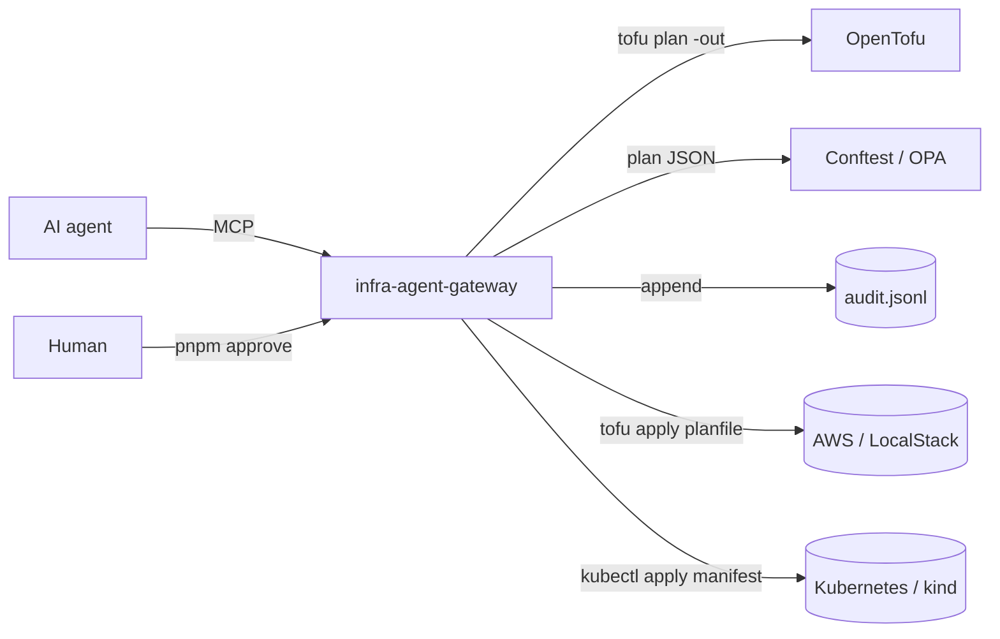

# infra-agent-gateway

An MCP server that lets AI agents like Claude **plan** infrastructure changes and **request** them, while every apply goes through policy as code, a human approval and an append-only audit log.

```
You:    "I need a small VM for the data team in dev."
Claude: plan_change → + aws_security_group.vm, + aws_instance.vm (t3.small). Policies passed.
        request_apply → pending approval. Run: pnpm approve 3f9c…
You:    pnpm approve 3f9c…  → yes → Apply complete! Resources: 2 added.

You:    "Same, but open SSH so I can get in from home."
Claude: plan_change → denied: aws_security_group.vm: SSH open to 0.0.0.0/0.
        I can't request that. Give me your IP range and I'll plan it scoped to that.
```

## How it works



| MCP tool | What it does |
|---|---|
| `plan_change` | Validates a structured intent (zod), runs `tofu plan -out`, evaluates the plan JSON with Conftest. Returns `planned` or `denied` with reasons. Changes nothing. |
| `request_apply` | Moves a `planned` plan to `pending_approval`. Refuses denied plans. Applies nothing. |
| `deploy_workload` | Renders a Deployment from a structured intent (image, replicas, namespace, limits), checks it with Conftest and, if compliant, leaves it `pending_approval`. Deploys nothing. |
| `detect_drift` | Re-plans the last applied intent for a workspace (`tofu plan -detailed-exitcode`) and reports what changed outside the gateway. Read-only: fixing drift goes through `plan_change`. |
| `get_audit_log` | Recent audit entries. |

There is no approve tool. See [ADR 0001](docs/adr/0001-agents-never-approve.md).

## Guardrails

| Risk | Control |
|---|---|
| Agent writes arbitrary infrastructure | Agents send a typed intent, never HCL; the module decides what gets built |
| Unsafe config (open SSH, huge instances, missing owner, prod, deletes) | Rego policies in `policy/`, unit-tested with `conftest verify` |
| Unsafe workloads (privileged, no cpu/memory limits, system namespaces) | Rego in `policy/k8s.rego`, checked against the rendered manifest |
| Agent applies its own change | No approve tool; the gateway also rejects non-`human:` approvers |
| Plan swapped or changed after review | sha256 of the plan file (or rendered manifest) checked at apply; applies the saved file, never re-plans ([ADR 0002](docs/adr/0002-apply-the-reviewed-plan-byte-for-byte.md)) |
| No accountability | Append-only JSONL audit: who, what, plan id, policy result, approver, outcome |
| Prompt injection via tool output | Output is data; AGENTS.md tells agents so, and no output can trigger an apply on its own |

**Known limits:** one VM shape so far; workspaces are selected per call, so concurrent plans aren't safe yet; the audit log is local (ship it to an immutable store like S3 Object Lock for real use).

## Run it

Needs Node 24, pnpm, OpenTofu, Conftest, Docker, kind, kubectl.

```bash
pnpm install
docker run -d --name localstack -p 4566:4566 localstack/localstack:4   # free AWS emulator (newer tags need a license)
kind create cluster --name iag    # the gateway only ever uses context kind-iag (override: KUBE_CONTEXT)

pnpm test               # gateway + MCP seams (fast, no tools needed)
pnpm test:policy        # Rego unit tests
INTEGRATION=1 pnpm test test/integration.test.ts   # real OpenTofu + Conftest + LocalStack + kind
```

Connect Claude Code:

```bash
claude mcp add infra-gateway -- pnpm --dir "$PWD" start
```

Approve from another terminal: `pnpm approve <planId>`.

## Tests

Written test-first at four seams: the gateway core (fakes only for the external CLIs), the MCP surface (a real MCP client over an in-memory transport), the policies (`conftest verify`), and an integration suite against real OpenTofu, Conftest, LocalStack and kind.
